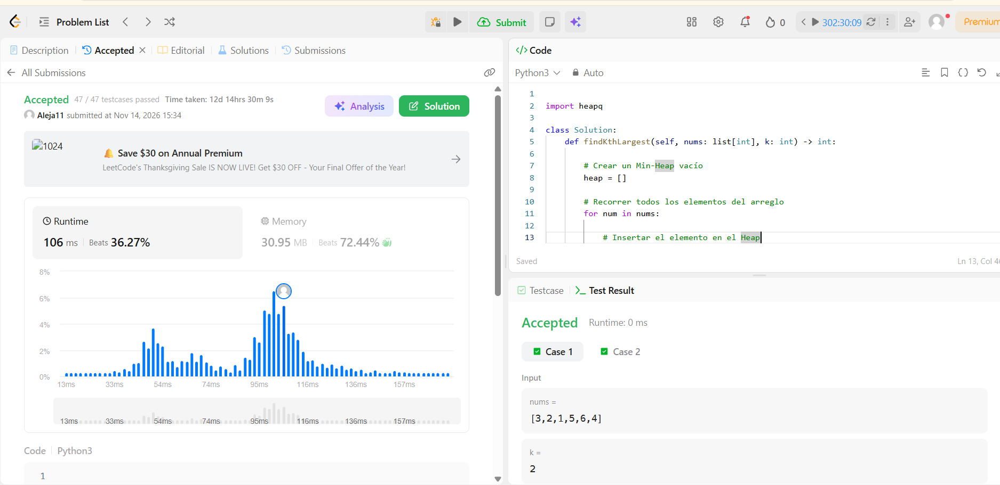
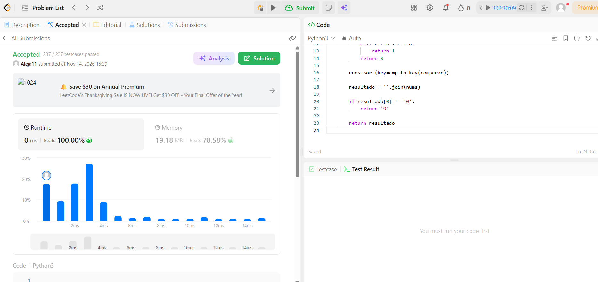
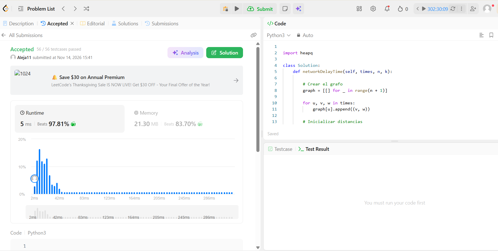
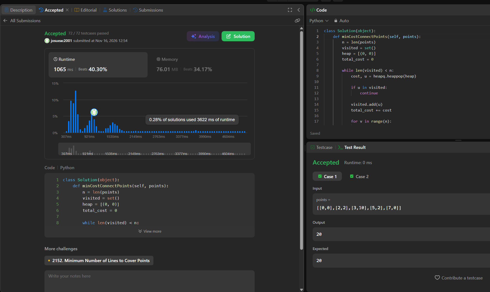
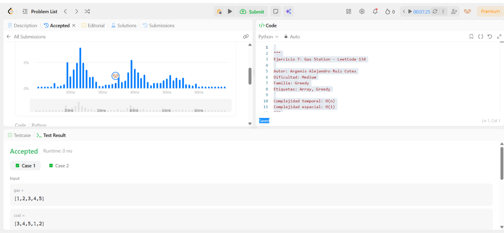
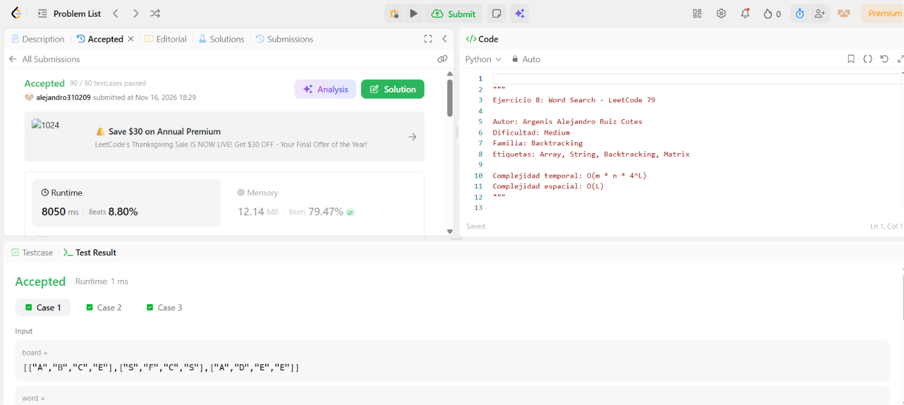

## 215. Kth Largest Element in an Array

**Autor:** Alejandra Carvajal Campo

https://leetcode.com/problems/kth-largest-element-in-an-array/

**Familia:** Heap (Min-Heap).

**Idea:** Se utiliza un Min-Heap de tamaño máximo k para mantener los k elementos más grandes del arreglo. Se recorren los elementos de nums y se insertan uno por uno en el heap. Cuando su tamaño supera k, se elimina el elemento más pequeño mediante heappop, garantizando que siempre se conserven únicamente los k mayores elementos encontrados. Al finalizar el recorrido, la raíz del Min-Heap contiene el k-ésimo elemento más grande del arreglo, sin necesidad de ordenar todos los elementos.

**Complejidad:** Tiempo $O(n \log k)$, donde $n$ es la cantidad de elementos de nums y $k$ es la posición del elemento más grande que se desea encontrar. Cada inserción y eliminación en el heap tiene un costo de $O(\log k)$ y se procesan los $n$ elementos. Espacio $O(k)$ extra para mantener el Min-Heap con un máximo de k elementos.

## 179. Largest Number

**Autor:** Alejandra Carvajal Campo

https://leetcode.com/problems/largest-number/

**Familia:** Ordenamiento (comparador personalizado).

**Idea:** Se convierten los números del arreglo en cadenas de texto para realizar un ordenamiento mediante un comparador personalizado. La comparación entre dos elementos a y b se realiza evaluando las concatenaciones a + b y b + a. Si a + b es mayor, a debe ubicarse primero; de lo contrario, se coloca b antes que a. De esta manera, se determina el orden que produce el número concatenado de mayor valor posible. Finalmente, se unen las cadenas ordenadas para construir el resultado. También se contempla el caso especial en el que todos los elementos son cero, retornando "0" en lugar de una cadena de ceros repetidos.

**Complejidad:** Tiempo $O(n \log n)$ comparaciones, donde $n$ es la cantidad de números del arreglo. Cada comparación tiene un costo proporcional a la longitud de las cadenas involucradas, debido a la concatenación y comparación de caracteres. Espacio $O(n)$ para almacenar las representaciones en cadenas y construir el resultado.

## 743. Network Delay Time

**Autor:** Alejandra Carvajal Campo

https://leetcode.com/problems/network-delay-time/

**Familia:** Grafos (Dijkstra).

**Idea:** Se representa la red mediante un grafo dirigido y ponderado utilizando una lista de adyacencia, donde cada conexión contiene un nodo destino y el peso correspondiente al tiempo de transmisión. Se aplica el algoritmo de Dijkstra desde el nodo inicial k, utilizando un Min-Heap para seleccionar siempre el nodo con la menor distancia acumulada. Se inicializan todas las distancias en infinito, excepto la del nodo de origen, que comienza en cero. Durante el recorrido se actualizan las distancias cuando se encuentra un camino más corto hacia un vecino. Al finalizar, se obtiene la distancia máxima entre todos los nodos, ya que representa el tiempo que debe transcurrir para que la señal llegue al último nodo. Si existe algún nodo cuya distancia permanece en infinito, significa que no es alcanzable y se retorna -1.

**Complejidad:** Tiempo $O((n + m) \log n)$, donde $n$ es la cantidad de nodos y $m$ es la cantidad de conexiones almacenadas en times. Se construye la lista de adyacencia en $O(n + m)$ y se utiliza un Min-Heap para procesar los nodos y actualizar las distancias. Espacio $O(n + m)$ para almacenar el grafo, el arreglo de distancias y la cola de prioridad.

## 1584. Min Cost to Connect All Points

**Autor:** Josue Acosta Londono (`Josue`)

https://leetcode.com/problems/min-cost-to-connect-all-points/description/

**Familia:** grafos

**Idea:** A diferencia de Dijkstra que busca caminos más cortos, aquí el objetivo es conectar a todos los nodos minimizando la suma total de la red (MST). El grafo es completo y el peso es la distancia Manhattan. Se optó por usar el algoritmo de Prim. se inicia en un punto arbitrario y, usando una cola de prioridad, se hace crecer el árbol seleccionando iterativamente la arista más barata que conecte el árbol actual con un punto no visitado.  

**Complejidad:** Tiempo $O(n^2 \log n)$ implementado con un min-heap, donde n es points.length; como el grafo es denso y exploramos todas las conexiones posibles desde cada nodo hacia los demás, se insertan hasta $n^2$ aristas en el heap, y cada extracción cuesta $O(\log n^2) = O(\log n)$. Espacio $O(n^2)$ en el peor caso para mantener la frontera de aristas en la cola de prioridad.

## 72. Edit Distance

**Autor:** Josué Acosta Londoño (`Josue`)  

https://leetcode.com/problems/edit-distance/description/

**Familia:** Programación dinámica (DP). 

**Idea:** El `dp[i][j]` almacena el mínimo de operaciones requeridas para convertir el prefijo `word1[0..i)` en `word2[0..j)`. La base se define como `dp[i][0] = i` (costo de borrar $i$ letras para vaciar la cadena) y `dp[0][j] = j` costo de insertar $j$ letras. La recurrencia dicta que si las letras actuales coinciden, el costo es `dp[i-1][j-1]`; de lo contrario, se toma el costo de la mejor edición: `1 + min(dp[i-1][j], dp[i][j-1], dp[i-1][j-1])` que corresponden a borrar, insertar o sustituir respectivamente.  

**Complejidad:** Tiempo $\Theta(n \cdot m)$ y Espacio $\Theta(n \cdot m)$, donde $n$ es la longitud de word1 y $m$ la longitud de word2. Se construye y recorre una matriz de tamaño $(n+1) \times (m+1)$ haciendo comparaciones de tiempo constante $O(1)$ en cada celda.

## 300. Longest Increasing Subsequence

**Autor:** Josué Acosta Londoño (`Josue`)  

https://leetcode.com/problems/longest-increasing-subsequence/description/

**Familia:** Programación dinámica (DP). 

**Idea:** El `dp[i]` almacena la longitud de la subsecuencia creciente (LIS) más larga que termina obligatoriamente en el índice $i$. La base es `dp[i] = 1` para todo $i$, ya que un elemento solo ya forma una subsecuencia válida. La recurrencia consiste en revisar todos los elementos anteriores ($j < i$); si el elemento anterior es menor (`nums[j] < nums[i]`), entonces `dp[i] = max(dp[i], 1 + dp[j])`. Finalmente, la respuesta se halla buscando el máximo global en toda la tabla, ya que la LIS no necesariamente termina en el último elemento.  

**Complejidad:** Tiempo $\Theta(n^2)$ ya que por cada uno de los $n$ elementos se revisan todos los $j$ elementos anteriores como un doble ciclo anidado. Espacio $\Theta(n)$ extra requerido para almacenar el arreglo `dp` unidimensional con las longitudes máximas hasta cada índice.

## Ejercicio 7: Gas Station

**Autor:** Argenis Alejandro Ruiz Cotes  

https://leetcode.com/problems/gas-station/description/

**Familia:** Greedy.

**Idea**: Si la suma total de gasolina es menor al costo total, el circuito es imposible. En un único recorrido lineal, el criterio local consiste en acumular el saldo del tanque (gas[i] - cost[i]). si el saldo se vuelve negativo, ninguna estación del tramo recorrido sirve como inicio, por lo que se descarta, se reinicia el tanque en cero y se elige la siguiente estación (i + 1) como nuevo candidato.  

**Complejidad:** Tiempo $O(n)$, donde $n$ es la cantidad de estaciones, ya que se realiza una sola pasada sobre los arreglos. Espacio $O(1)$ auxiliar, utilizando únicamente variables escalares para el saldo del tanque y el índice de inicio.

## Ejercicio 8: Word Search

**Autor:** Argenis Alejandro Ruiz Cotes

**Problema:** [79. Word Search](https://leetcode.com/problems/word-search/)

**Familia:** Backtracking.

**Idea**  Se lanza una búsqueda desde cada celda de la matriz que coincida con la primera letra de la palabra. En cada paso se elige una celda vecina ortogonal con la siguiente letra y se marca como visitada; si la rama no completa la palabra, se deshace la elección restaurando la letra original en la matriz para permitir que otros caminos la utilicen.  

**Complejidad:** Tiempo $O(m \cdot n \cdot 4^L)$, donde m y n son las dimensiones de la matriz (filas y columnas) y L es la longitud de la palabra, al explorar hasta 4 direcciones en cada nivel de profundidad. Espacio $O(L)$ auxiliar correspondiente a la profundidad máxima de la pila de recursión.

