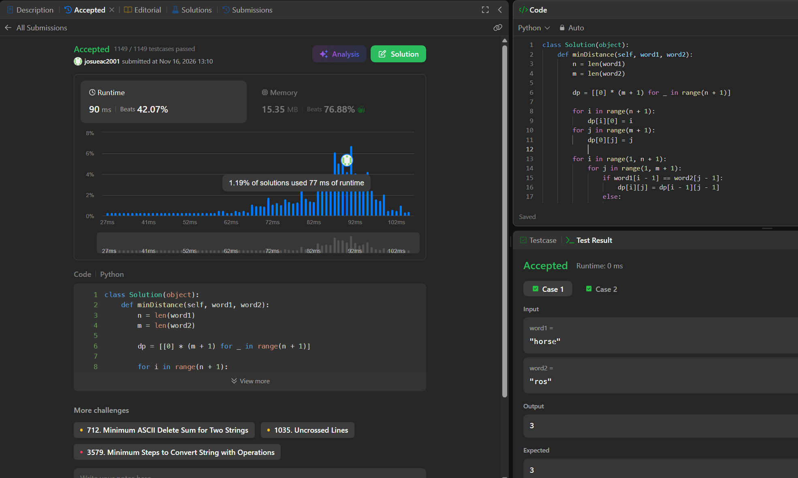
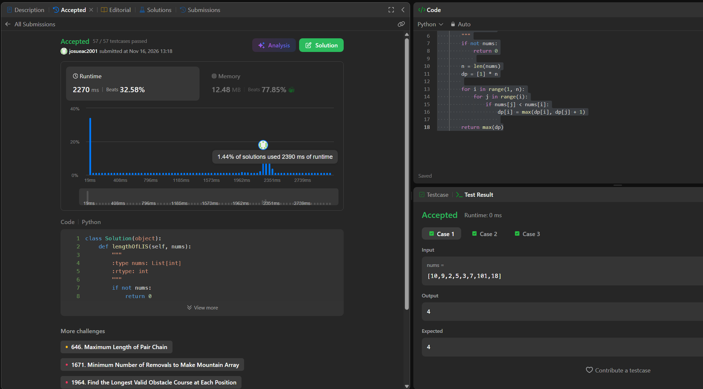

## 1584. Min Cost to Connect All Points

**Autor:** Josue Acosta Londono (`Josue`)

https://leetcode.com/problems/min-cost-to-connect-all-points/description/

**Familia:** grafos (árbol de recubrimiento mínimo)  

**Idea:** A diferencia de Dijkstra que busca caminos más cortos, aquí el objetivo es conectar a todos los nodos minimizando la suma total de la red (MST). El grafo es completo y el peso es la distancia Manhattan. Se optó por usar el algoritmo de Prim. se inicia en un punto arbitrario y, usando una cola de prioridad, se hace crecer el árbol seleccionando iterativamente la arista más barata que conecte el árbol actual con un punto no visitado.  

**Complejidad:** Tiempo $O(n^2 \log n)$ implementado con un min-heap, donde n es points.length; como el grafo es denso y exploramos todas las conexiones posibles desde cada nodo hacia los demás, se insertan hasta $n^2$ aristas en el heap, y cada extracción cuesta $O(\log n^2) = O(\log n)$. Espacio $O(n^2)$ en el peor caso para mantener la frontera de aristas en la cola de prioridad.

## 72. Edit Distance

https://leetcode.com/problems/edit-distance/description/

**Autor:** Josué Acosta Londoño (`Josue`)  

**Familia e Idea:** Programación dinámica (DP). El `dp[i][j]` almacena el mínimo de operaciones requeridas para convertir el prefijo `word1[0..i)` en `word2[0..j)`. La base se define como `dp[i][0] = i` (costo de borrar $i$ letras para vaciar la cadena) y `dp[0][j] = j` costo de insertar $j$ letras. La recurrencia dicta que si las letras actuales coinciden, el costo es `dp[i-1][j-1]`; de lo contrario, se toma el costo de la mejor edición: `1 + min(dp[i-1][j], dp[i][j-1], dp[i-1][j-1])` que corresponden a borrar, insertar o sustituir respectivamente.  

**Complejidad:** Tiempo $\Theta(n \cdot m)$ y Espacio $\Theta(n \cdot m)$, donde $n$ es la longitud de word1 y $m$ la longitud de word2. Se construye y recorre una matriz de tamaño $(n+1) \times (m+1)$ haciendo comparaciones de tiempo constante $O(1)$ en cada celda.

## 300. Longest Increasing Subsequence

https://leetcode.com/problems/longest-increasing-subsequence/description/

**Autor:** Josué Acosta Londoño (`Josue`)  

**Familia e Idea:** Programación dinámica (DP). El `dp[i]` almacena la longitud de la subsecuencia creciente (LIS) más larga que termina obligatoriamente en el índice $i$. La base es `dp[i] = 1` para todo $i$, ya que un elemento solo ya forma una subsecuencia válida. La recurrencia consiste en revisar todos los elementos anteriores ($j < i$); si el elemento anterior es menor (`nums[j] < nums[i]`), entonces `dp[i] = max(dp[i], 1 + dp[j])`. Finalmente, la respuesta se halla buscando el máximo global en toda la tabla, ya que la LIS no necesariamente termina en el último elemento.  

**Complejidad:** Tiempo $\Theta(n^2)$ ya que por cada uno de los $n$ elementos se revisan todos los $j$ elementos anteriores como un doble ciclo anidado. Espacio $\Theta(n)$ extra requerido para almacenar el arreglo `dp` unidimensional con las longitudes máximas hasta cada índice.

